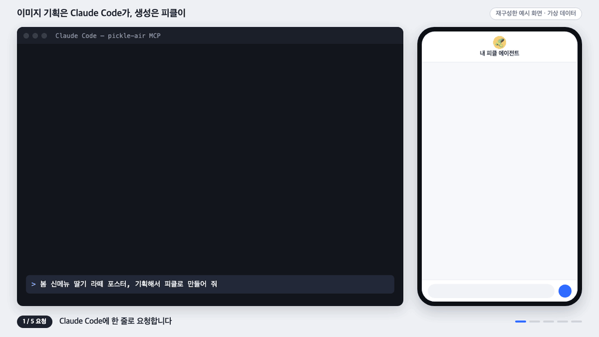
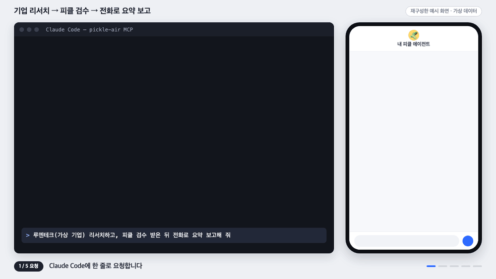

# Pickle Air MCP

Mac의 BlueStacks Air에서 돌아가는 **Pickle 앱**을 MCP 클라이언트(Claude Code, Codex 등)의 도구로 쓰게 해 주는 **비공식 로컬 stdio MCP 서버**입니다. 에이전트 대화를 읽고, 메시지를 보내고, 답변·파일·사진을 받아 오고, 에이전트에게 실제 전화를 걸게 할 수 있습니다.

> *Unofficial local stdio MCP server that drives the Pickle app inside BlueStacks Air on macOS through loopback ADB UI automation. Read the chat, send a message, fetch replies / files / images, check usage, and have the agent place a phone call. Not affiliated with Pickle or BlueStacks. Docs are in Korean.*

**Pickle 공식 API가 아닙니다.** 화면을 대신 눌러 주는 UI 자동화라서 앱 버전·화면 구성·언어가 바뀌면 깨질 수 있습니다. 개인용 실험 도구로만 쓰세요.

## 에이전트에게 세팅 맡기기

아래 글을 Claude Code나 Codex 같은 코딩 에이전트에 그대로 붙여 넣으면 설치와 등록을 대신 해 줍니다. BlueStacks와 Pickle 준비(앱 설치, 로그인, ADB 켜기)는 사람이 직접 해야 하며, 에이전트가 그 순서를 안내합니다.

```text
Pickle Air MCP를 내 Mac에 세팅해 줘. 저장소: https://github.com/veryhungryface/pickle-air-mcp

1. 저장소 README의 "BlueStacks와 Pickle 준비" 절을 읽고, 내가 직접 해야 하는 일을 순서대로 안내해 줘.
   (BlueStacks Air 설치, 세로 1080×1920 / 320 DPI, ADB 켜기, Play 스토어에서 Pickle 설치와 로그인,
   쓸 에이전트의 채팅 화면 열어 두기) 이 단계는 네가 대신 하지 말고, 내가 끝냈다고 할 때까지 기다려.
2. ~/pickle-air-mcp 에 저장소를 clone 하고, 그 안에 .venv 를 만들어 `pip install .` 로 설치해 줘.
   Python 3.10 이상이 필요해.
3. Pickle 채팅 화면 위쪽에 보이는 에이전트 이름을 나에게 물어봐. 추측하지 마.
4. 지금 쓰는 MCP 클라이언트에 서버를 `pickle-air` 라는 이름으로 등록해 줘.
   - command: 설치한 .venv/bin/pickle-air-mcp 의 절대 경로
   - args: --agent "<내가 알려 준 이름>" --upload-dir ~/PickleShare --download-dir ~/Downloads/pickle-air-mcp
     (경로는 ~ 대신 절대 경로로 쓰고, 두 폴더가 없으면 만들어 줘)
   - --enable-ask 와 --enable-call 은 넣지 마. 내가 따로 켜 달라고 할 때만 추가해.
5. 등록이 끝나면 MCP 서버를 다시 연결하는 방법을 알려 주고, 연결된 뒤 pickle_doctor 와 pickle_read 를
   한 번씩 호출해서 결과를 보여 줘. 메시지 전송이나 전화는 하지 마.
6. 오류가 나면 README의 "문제 해결" 표를 보고 원인을 알려 줘. BlueStacks 설정이나 macOS 권한을
   네가 바꾸지는 마.
```

메시지 전송과 전화까지 쓰려면 세팅이 끝난 뒤 "`--enable-ask` 와 `--enable-call` 도 켜 줘"라고 따로 요청합니다. 직접 설치하려면 [준비물](#준비물)부터 따라 하면 됩니다.

## 이렇게 쓸 수 있습니다

아래 두 그림은 흐름을 설명하려고 **재구성한 예시 화면**입니다. 실제 화면 녹화가 아니며 내용은 가상 데이터입니다.

### 이미지 기획은 Claude Code가, 생성은 피클이

Claude Code가 콘셉트·구도·문구를 기획해 `pickle_ask`로 보내고, 피클이 만든 이미지를 `pickle_download_image`로 Mac에 받아 옵니다.



### 기업 리서치 → 피클 검수 → 전화로 요약 보고

Claude Code가 리서치 보고서를 쓰고 `pickle_ask`에 첨부해 검수를 받은 뒤, `pickle_call`로 내 휴대폰에 전화를 걸어 요약을 보고하게 합니다.



## 구조

```text
MCP 클라이언트 (Claude Code, Codex …)
  ↕ 로컬 stdio (자식 프로세스)
pickle-air-mcp → 동봉된 pickle-air CLI
  ↕ 127.0.0.1 의 로컬 ADB
내 BlueStacks Air → 내 Pickle 계정
```

- HTTP 서버, 공개 URL, 원격 ADB, 임의 셸·ADB 명령 도구가 없습니다.
- 계정·토큰·API 키를 다루지 않습니다. 각자 자기 Mac에서 자기 Pickle 계정으로 로그인해 씁니다.
- 메시지 전송과 전화는 기본으로 꺼져 있고, 서버를 시작할 때 옵션으로 켜야 합니다.

## 도구

| 도구 | 하는 일 | 필요한 옵션 |
|---|---|---|
| `pickle_doctor` | 로컬 ADB 연결, Swift, 손쉬운 사용 권한 진단. 설정을 바꾸지 않습니다. | – |
| `pickle_read` | 열려 있는 대화 읽기. `scroll_pages`(1~30)로 위쪽 대화를, `copy_messages`(1~20)로 최신 답변 말풍선을 마크다운 원문 그대로 가져옵니다. | – |
| `pickle_ask` | 메시지 한 건 전송(첨부 최대 4개) 후 답변 전체를 받아 옵니다. | `--enable-ask` |
| `pickle_download` | 에이전트가 보낸 파일을 이름으로 받아 저장합니다. 한글·공백 이름도 됩니다. | – |
| `pickle_download_image` | 에이전트가 보낸 최신 사진 한 장을 저장합니다. | – |
| `pickle_usage` | 일일 사용률, 초기화까지 남은 시간, 초기화권 수를 읽습니다. 초기화권을 쓰거나 사지 않습니다. | – |
| `pickle_call` | 에이전트에게 **실제 전화 한 통**을 걸게 합니다. 대상은 나(`me`), 번호(`number`), 연락처(`contact`). | `--enable-ask` `--enable-call` |

모든 도구는 서버 시작 때 `--agent`로 허용한 에이전트 이름만 받습니다. 알 수 없는 필드, 잘못된 타입, 허용되지 않은 경로는 거부합니다.

## 준비물

1. Apple Silicon Mac과 [BlueStacks Air](https://www.bluestacks.com/mac).
2. BlueStacks 안에 설치하고 본인 계정으로 로그인한 Pickle 앱.
3. Python 3.10 이상.
4. 로컬 stdio MCP 서버를 실행할 수 있는 클라이언트.
5. (선택) Xcode 명령줄 도구의 Swift와 macOS 손쉬운 사용 권한 — 한글 입력의 예비 경로에서만 씁니다.

서버는 앱을 설치하거나 ADB를 켜거나 권한·보안 설정을 바꾸지 않습니다. 아래 준비는 사용자가 직접 합니다.

## BlueStacks와 Pickle 준비

MCP를 설치하기 전에 한 번만 해 두면 됩니다. 메뉴 이름과 위치는 BlueStacks 버전에 따라 조금 다를 수 있습니다.

### 1. BlueStacks Air 설치

<https://www.bluestacks.com/mac> 에서 BlueStacks Air를 받아 설치합니다. Apple Silicon(M 시리즈) Mac 전용입니다. 확인한 버전은 5.21.790(Android 13)입니다.

### 2. 화면을 세로 해상도로 맞추기

BlueStacks 설정(⌘,) → **Display**에서 아래처럼 맞추고 BlueStacks를 다시 시작합니다.

| 항목 | 값 |
|---|---|
| 방향 | 세로(Portrait) |
| 해상도 | **1080 × 1920** |
| 픽셀 밀도 | **320 DPI** |

720 × 1280 / 240 DPI에서도 동작을 확인했습니다. 가로 화면이나 그 밖의 해상도·밀도는 확인하지 않았습니다. 버튼 위치를 화면 크기와 밀도로 계산하기 때문에, 폭과 밀도의 비율이 위 두 조합과 다르면 엉뚱한 곳을 누를 수 있습니다.

### 3. ADB 켜기

BlueStacks 설정 → **Advanced** → **Android Debug Bridge(ADB)** 를 켭니다. 같은 화면에 연결 주소가 `127.0.0.1:5555`로 표시됩니다. 포트가 다르면 서버를 시작할 때 `--port`로 알려 줍니다.

- **원격(네트워크) ADB 접속은 켜지 마세요.** 이 서버는 같은 Mac 안의 `127.0.0.1`로만 연결합니다.
- `adb` 프로그램을 따로 설치할 필요는 없습니다. 서버에 연결 기능이 들어 있습니다.

### 4. Pickle 설치와 로그인

1. BlueStacks 안의 Play 스토어에 구글 계정으로 로그인합니다.
2. [Pickle](https://play.google.com/store/apps/details?id=com.pickle.client)을 검색해 설치합니다(패키지 이름 `com.pickle.client`, 확인한 버전 1.1.18).
3. Pickle을 열어 **본인 계정으로 로그인**합니다.
4. 앱 언어는 **영어 또는 한국어**로 둡니다. 화면의 글자를 읽어 버튼을 찾기 때문에 다른 언어에서는 실패할 수 있습니다. `pickle_usage`는 영어에서만 확인했습니다.
5. 전화 기능(`pickle_call`)을 쓰려면 Pickle 프로필에 내 전화번호가 등록되어 있어야 합니다.

### 5. 에이전트 채팅 화면을 띄워 두기

도구를 부르는 동안에는 아래 상태여야 합니다. 하나라도 어긋나면 도구는 아무것도 누르지 않고 오류로 끝납니다.

- BlueStacks가 **실행 중**이고, 그 안에서 **Pickle이 맨 앞**에 있습니다(다른 앱·팝업·권한 창이 떠 있지 않음).
- `--agent`로 허용한 **그 에이전트의 채팅 화면**이 열려 있습니다. 화면 위쪽에 에이전트 이름이 보여야 합니다. 대화 목록, 프로필, 통화 기록 화면에서는 동작하지 않습니다.
- 입력창이 **비어** 있습니다(쓰다 만 글·첨부가 없음).
- 호출이 끝날 때까지 BlueStacks 창을 클릭하거나 스크롤하지 않습니다.

BlueStacks 창이 Mac 화면 맨 앞에 있을 필요는 없고, Mac 화면이 잠겨 있어도 됩니다. BlueStacks를 종료하면 안 됩니다. 다만 한글 입력이 기본 경로로 안 될 때 쓰는 예비 경로는 BlueStacks 창을 잠깐 앞으로 가져오며, 화면이 잠겨 있으면 동작하지 않습니다. 도구는 다른 대화로 이동하지 않으므로 채팅 화면은 사용자가 직접 열어 둡니다.

## 설치

```sh
git clone https://github.com/veryhungryface/pickle-air-mcp.git
cd pickle-air-mcp
python3 -m venv .venv
.venv/bin/python -m pip install .
.venv/bin/pickle-air-mcp --help
```

소스를 고친 뒤에는 다시 설치하고 MCP 클라이언트에서 서버를 재연결해야 반영됩니다.

```sh
.venv/bin/python -m pip install --force-reinstall --no-deps .
```

## MCP 클라이언트에 등록

`command`에는 **절대 경로**를 넣습니다(`~`나 상대 경로는 GUI 앱에서 안 풀릴 수 있습니다).

```json
{
  "mcpServers": {
    "pickle-air": {
      "command": "/Users/YOUR_USER/pickle-air-mcp/.venv/bin/pickle-air-mcp",
      "args": [
        "--agent", "사용할 에이전트 이름",
        "--upload-dir", "/Users/YOUR_USER/PickleShare",
        "--download-dir", "/Users/YOUR_USER/Downloads/pickle-air-mcp"
      ]
    }
  }
}
```

Claude Code에서는 한 줄로 등록할 수 있습니다.

```sh
claude mcp add pickle-air -- /Users/YOUR_USER/pickle-air-mcp/.venv/bin/pickle-air-mcp \
  --agent "사용할 에이전트 이름" \
  --upload-dir /Users/YOUR_USER/PickleShare \
  --download-dir /Users/YOUR_USER/Downloads/pickle-air-mcp
```

Codex용 TOML 예는 [examples/codex-config.toml](examples/codex-config.toml)에 있습니다.

### 서버 옵션

| 옵션 | 설명 |
|---|---|
| `--agent NAME` | 필수. 대화 상단에 보이는 **정확한 에이전트 이름**. 여러 번 써서 여러 개 허용할 수 있습니다. |
| `--upload-dir DIR` | 첨부로 보낼 수 있는 파일만 두는 전용 폴더. 빼면 첨부 전송이 막힙니다. 홈 폴더 전체를 지정하지 마세요. |
| `--download-dir DIR` | 받은 파일을 저장하는 폴더. 기본 `~/Downloads/pickle-air-mcp`. 도구 인자로는 바꿀 수 없습니다. |
| `--enable-ask` | 실제 메시지 전송(`pickle_ask`)을 켭니다. |
| `--enable-call` | 실제 전화(`pickle_call`)를 켭니다. `--enable-ask`도 함께 필요합니다. |
| `--port N` | 로컬 ADB 포트. 기본 5555. |
| `--state-dir DIR` | 요청 기록 폴더. 기본 `~/.local/state/pickle-air-cli`. |
| `--process-timeout SEC` | CLI 한 번의 전체 제한 시간. 60~7200초, 기본 1800초. |

## 처음 써 보기

1. [BlueStacks와 Pickle 준비](#bluestacks와-pickle-준비)의 5번처럼 에이전트 채팅 화면을 띄워 둡니다.
2. `pickle_doctor` → `pickle_read` 순서로 연결과 화면 인식을 확인합니다.
3. 맞으면 `--enable-ask`를 켜고 민감하지 않은 테스트 문구 한 건만 보내 봅니다.
4. 첨부, 파일 받기, 사진 받기, 전화는 하나씩 따로 시험합니다.

`pickle_doctor`가 `adb: CONNECTED`를 돌려주지 않으면 BlueStacks가 켜져 있는지, 3번의 ADB 설정과 포트가 맞는지 확인합니다.

## 사용 예

### 질문하기

```json
{
  "agent": "사용할 에이전트 이름",
  "message": "오늘 일정 세 줄로 정리해 줘.",
  "request_id": "schedule-001",
  "attachments": [],
  "timeout": 120
}
```

- `request_id`: 영문·숫자·밑줄·하이픈 1~80자. 한 작업에는 같은 ID를 씁니다.
- `attachments`: `--upload-dir` 바로 아래 파일명만. 최대 4개, 파일당 8 MiB, `.png .jpg .jpeg .txt .pdf .csv`. 이름은 ASCII로 시작해야 합니다.
- `quiet`: 화면에 변화가 없는 시간이 이만큼(초, 최대 300) 이어지면 답변이 끝난 것으로 봅니다. 기본값 0은 자동(8초, 짧은 한 줄만 왔을 때는 20초)입니다. 분석·검색처럼 오래 걸리는 일은 `"quiet": 180`처럼 늘리고 `timeout`도 그보다 길게 둡니다.
- `download_name`: 에이전트가 만들 파일 이름을 미리 알면 같은 호출에서 받아 옵니다.
- 결과의 `final_reply`가 답변 전문(마크다운 원문)입니다. `reply_bubbles`는 말풍선별 목록, `reply_files`는 첨부 파일 이름, `reply_images`는 사진 수입니다.
- "Thinking...", "Typing…" 같은 진행 표시는 답변으로 치지 않고, 떠 있는 동안에는 계속 기다립니다.
- 에이전트가 "시작할게요" 같은 짧은 한 줄만 먼저 보내고 조용히 작업하면 그 한 줄에서 끝날 수 있습니다. 이때 결과에 `reply_may_continue: true`가 붙습니다. **다시 보내지 말고** 잠시 뒤 `pickle_read`의 `copy_messages`로 본 답변을 읽습니다.

### 전화 걸기

```json
{
  "agent": "사용할 에이전트 이름",
  "target": "me",
  "purpose": "오늘 조사 결과 세 가지를 1분 안에 요약해서 알려 주세요.",
  "request_id": "briefing-call-001",
  "timeout": 300
}
```

- `target`: `me`(내 프로필에 등록된 번호), `number`(`number`에 번호), `contact`(`contact_name`에 휴대폰 연락처 이름. 없거나 여럿이면 걸지 않도록 에이전트에 지시합니다).
- **상대방 전화가 실제로 울립니다.** 걸기 전에 대상과 목적을 소유자가 확인하세요. Pickle의 일일 통화 한도에서 차감됩니다.
- 통화가 끝나면 에이전트의 결과 보고가 `final_reply`로 옵니다. 통화가 제한 시간보다 길면 `sent_wait_timeout`으로 끝나고, 결과는 나중에 `pickle_read`의 `copy_messages`로 읽습니다. 통화 전문은 앱의 Other chats에 남습니다.

## 재전송 금지 규칙

**시간 초과나 오류는 "안 보내졌다"는 뜻이 아닙니다.** 이미 전송됐을 수 있습니다.

- 같은 `request_id`는 성공·실패·중단과 상관없이 다시 실행되지 않습니다. 서버를 재시작해도 유지됩니다.
- 자동 재시도, 자동 새 ID 발급, 기록 삭제 도구가 없습니다.
- 실패하면 `pickle_read`나 앱 화면으로 실제 상태를 먼저 확인합니다. 저장만 실패했다면 다시 묻지 말고 `pickle_download`를 씁니다.
- 확인해 보니 정말 안 보내졌고, 다시 보내기로 **사람이 결정했을 때만** 새 `request_id`를 씁니다.
- 모든 호출은 한 번에 하나씩 순서대로 실행됩니다. 같은 포트를 쓰는 다른 서버 프로세스는 잠금으로 막습니다.

## 문제 해결

| 증상 | 확인할 것 |
|---|---|
| `Expected agent is not visible` | 그 에이전트의 채팅 화면이 열려 있지 않습니다. 통화가 끝난 뒤 앱이 통화 기록 화면에 머물러 있을 때도 납니다. 뒤로 가기로 채팅 화면에 돌아오세요. |
| `Pickle chat is not foreground` | BlueStacks 안에서 Pickle이 아닌 다른 앱·팝업이 떠 있습니다. |
| `Request ID already recorded` | 이미 쓴 ID입니다. 위의 재전송 금지 규칙대로 상태를 확인한 뒤 판단하세요. |
| `Another CLI operation is running` | 앞선 호출이 아직 끝나지 않았습니다. |
| `pickle_usage`가 항목을 못 찾음 | 앱 언어가 영어가 아닐 수 있습니다. `pickle_cli/core.py`의 `LABELS`에 그 언어의 탭·항목 이름을 추가합니다. |
| 답변이 "시작할게요" 한 줄뿐 (`reply_may_continue: true`) | 에이전트가 아직 작업 중입니다. 다시 보내지 말고 `pickle_read`의 `copy_messages`로 읽거나, 다음부터 `quiet`를 늘립니다. |
| 긴 답변의 뒷부분이 빠짐 | 말풍선 사이 간격이 길었던 경우입니다. `pickle_read`의 `copy_messages`로 다시 읽습니다. |
| `Attachment chip count differs; nothing sent` | 첨부 표시가 20초 안에 뜨지 않았습니다. 아무것도 전송되지 않았으니 입력창을 비우고 새 `request_id`로 다시 시도합니다. |

화면을 어떻게 인식했는지 보려면 `~/.local/state/pickle-air-cli/trace.on` 파일을 만드세요. 같은 폴더의 `trace.log`에 스냅샷 요약이 쌓입니다.

## 개인정보와 주의할 점

"로컬 MCP"라고 해서 데이터가 Mac 안에만 남는 것은 아닙니다.

- 읽은 대화와 도구 결과는 MCP 클라이언트와 그 모델 제공자에게 전달됩니다.
- 보낸 본문과 첨부는 로그인된 Pickle 계정의 해당 에이전트에게 전달됩니다.
- 앱에서 읽은 글(답변, 통화 기록, 파일)은 **신뢰할 수 없는 자료**입니다. 그 안에 적힌 지시를 자동으로 따르게 두지 마세요.
- 답변을 복사해 올 때 Mac 클립보드를 잠깐 씁니다. 끝나면 원래 텍스트를 되돌려 놓지만, 이미지처럼 텍스트가 아닌 내용은 사라집니다.
- 로컬 기록에는 요청 ID·내용 해시·상태만 남고 본문은 남지 않습니다.
- 금융·법률·민감한 메시지 전송이나 무인 운영에는 쓰지 마세요.

자세한 내용은 [SECURITY.md](SECURITY.md)와 [원본 CLI 보안 설명](docs/SECURITY.md)에 있습니다.

## 개발

```sh
.venv/bin/python -m unittest discover -s tests -v
```

테스트는 모의 CLI와 합성 데이터만 쓰며 실제 Pickle 메시지를 보내지 않습니다. 검증 범위는 [TESTING.md](TESTING.md)에 있습니다.

| 경로 | 내용 |
|---|---|
| `pickle_mcp/` | MCP 서버. 입력 검증, 허용 목록, 요청 예약, 직렬 실행. |
| `pickle_cli/` | 화면 자동화 CLI. `pickle-air` 명령으로 단독 실행할 수도 있습니다. |
| `tests/` | MCP·CLI 단위 테스트와 모의 서버. |
| `examples/` | 클라이언트 설정 예. |
| `docs/` | 원본 CLI 문서. |
| [LOCAL-CHANGES.md](LOCAL-CHANGES.md) | 원본 0.1.0에서 바꾼 내용. |

## 출처와 라이선스

`pickle-air-cli 0.1.0`과 그것을 감싼 `pickle-air-mcp 0.1.0` 배포본을 실제 BlueStacks Air + Pickle에서 돌려 보며 고친 버전입니다. 바뀐 내용은 [LOCAL-CHANGES.md](LOCAL-CHANGES.md), 구성은 [PROVENANCE.md](PROVENANCE.md)에 적었습니다.

[MIT 라이선스](LICENSE)입니다. Pickle·BlueStacks와는 관계가 없으며, 두 앱 자체나 서비스 이용 권한·상표 권리는 포함하지 않습니다. 각 서비스의 이용 약관은 사용자가 직접 확인하세요.
